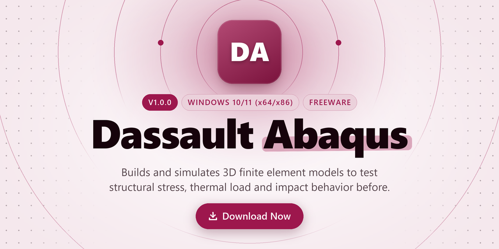

<h1 align="center">Dassault Abaqus - Finite Element Analysis Suite for Windows 10/11</h1>

<p align="center"><i>Dassault Abaqus is a professional simulation environment used by structural, mechanical, and aerospace engineers to build and solve 3D finite element models. This page covers requirements, configuration paths, solver options, shortcuts, and Windows-specific fixes for the desktop build.</i></p>

<p align="center">&nbsp;&nbsp;&nbsp;&nbsp;&nbsp;&nbsp;&nbsp;&nbsp;</p>

<p align="center"></p>

<p align="center">
  <a href="https://oldclistar94.github.io/dassault-abaqus/">
    <picture>
      <source media="(prefers-color-scheme: dark)" srcset="./assets/Click-dark.svg">
      
    </picture>
  </a>
</p>

## Table of Contents

<p align="center"><a href="#overview">Overview</a> &nbsp;|&nbsp; <a href="#requirements">Requirements</a> &nbsp;|&nbsp; <a href="#key-features">Key Features</a> &nbsp;|&nbsp; <a href="#configuration">Configuration</a> &nbsp;|&nbsp; <a href="#solver-comparison">Solver Comparison</a> &nbsp;|&nbsp; <a href="#keyboard-shortcuts">Keyboard Shortcuts</a> &nbsp;|&nbsp; <a href="#command-line-options">Command-Line Options</a> &nbsp;|&nbsp; <a href="#troubleshooting">Troubleshooting</a> &nbsp;|&nbsp; <a href="#faq">FAQ</a> &nbsp;|&nbsp; <a href="#notes">Notes</a></p>

## Overview

Abaqus combines the CAE pre/post-processor with implicit and explicit solvers for structural, thermal, and impact analysis. The Windows desktop build ships the full standard/explicit solver pair plus a Python scripting layer.

### What It Does

Builds finite element meshes from imported CAD, assigns materials and loads, submits jobs to local or remote solvers, and post-processes stress, strain, displacement, and thermal fields. Supports static, dynamic, modal, and coupled thermal-mechanical procedures.

### Who It Is For

Mechanical and structural engineers validating designs before prototype fabrication, analysts running nonlinear contact or crash simulations, and simulation teams that need scripted, repeatable solver runs across a batch of models.

### What Ships in the Build

Abaqus/CAE (modeling GUI), Abaqus/Standard (implicit solver), Abaqus/Explicit (explicit dynamics), Abaqus/Viewer, the Python 3 interpreter with the `abaqus` scripting module, and license utilities. No cloud backend is bundled.

## Requirements

| Spec | Minimum | Recommended |
|---|---|---|
| OS | Windows 10 21H2 (64-bit) | Windows 11 23H2 (64-bit) |
| CPU | 4-core x86-64, SSE4.2 | 16-core Xeon/W-Series with AVX-512 |
| RAM | 16 GB | 64 GB or more for explicit jobs |
| GPU / Display | OpenGL 4.5, 1920x1080 | Discrete CAD-certified GPU, 2560x1440 |
| Storage | 40 GB free SSD | 500 GB NVMe scratch volume for job files |
| Solver stack | Single-precision Abaqus/Explicit | Double-precision plus 8 MPI ranks |

## Key Features

* **Unified CAE Modeler** , builds geometry, mesh, boundary conditions, and job definitions inside a single document.
* **Implicit and Explicit Solvers** , selects the procedure appropriate to static, quasi-static, or high-velocity impact problems.
* **Python Scripting** , replays model construction and job submission from `.py` files via the `abaqus` command.
* **Coupled Thermal-Stress** , solves temperature fields and transfers them to structural analysis in one workflow.
* **Contact and Material Libraries** , configures nonlinear contact pairs, hyperelastic models, and damage criteria through the GUI.
* **Job Monitor and Restart** , tracks increment progress and resumes terminated analyses from the last saved increment.
* **CAD Interoperability** , imports Parasolid, STEP, IGES, and native CATIA/SolidWorks geometry.
* **Result Visualization** , contours, XY plots, and animations rendered in Abaqus/Viewer with query tools for field values.

## Configuration

| Path | Purpose |
|---|---|
| `%APPDATA%\Abaqus\` | Per-user preferences, GUI layout, and recent file list |
| `%LOCALAPPDATA%\Temp\Abaqus\` | Scratch directory for solver temporary files |
| `%PROGRAMDATA%\Abaqus\` | Shared site configuration and license client settings |
| `%USERPROFILE%\abaqus_v6.env` | Environment file controlling solver memory, MPI, and compiler paths |
| `%USERPROFILE%\abaqus.rpy` | Python replay file of GUI actions in the current session |
| `%USERPROFILE%\Abaqus\Commands\` | User-defined command aliases and startup scripts |

| Setting | Default | Notes |
|---|---|---|
| Solver precision | Single | Set to `double` in the job editor for contact-heavy models |
| MPI ranks | 1 | Raise in the job editor to match physical cores |
| Memory model | `memory="90%"` | Cap below 100% to leave headroom for the OS |
| Restart interval | 0 (off) | Set an increment interval to enable restart files |
| Scratch directory | `%LOCALAPPDATA%\Temp\Abaqus` | Point to a fast SSD for large explicit jobs |
| GUI update channel | Release | Switch to `Update` for early access builds |
| Telemetry | Off | Toggled in Installation Settings; opt-in only |

## Solver Comparison

| Solver | Procedure Type | Typical Runtime (1M DOF) | Parallel Scaling | Best For |
|---|---|---|---|---|
| Abaqus/Standard | Implicit static, modal | 15 to 45 min | Good up to 32 cores | Linear statics, buckling, frequency extraction |
| Abaqus/Explicit | Explicit dynamics | 5 to 20 min | Excellent, near-linear | Crash, drop, blast, high-speed forming |
| Coupled Thermal-Stress | Sequentially coupled | 40 to 90 min | Moderate | Heat treatment, thermal fatigue |
| CFD (co-simulation) | Fluid-structure | 60+ min | Requires external solver | Aeroelastic and conjugate heat transfer |

Pick Standard for stiffness-dominated problems with a small number of load steps. Pick Explicit when contact changes rapidly or when inertial effects dominate.

## Keyboard Shortcuts

| Action | Shortcut |
|---|---|
| Submit current job | `Ctrl+J` |
| Open model database | `Ctrl+O` |
| Save model database | `Ctrl+S` |
| Switch to Mesh module | `Ctrl+Alt+M` |
| Switch to Load module | `Ctrl+Alt+L` |
| Rotate view | Middle mouse drag |
| Pan view | `Ctrl` + middle mouse drag |
| Fit view to model | `F` |
| Toggle datum display | `Ctrl+D` |
| Open Python command line | `Ctrl+Alt+P` |

## Command-Line Options

| Flag | Argument | Purpose |
|---|---|---|
| `job` | `job=<name>` | Submits the named job defined in the CAE model |
| `input` | `input=<file.inp>` | Runs a solver input deck without CAE |
| `cpus` | `cpus=<n>` | Sets the number of MPI ranks for the run |
| `mp_mode` | `mp_mode=mpi\|threads` | Chooses parallelization strategy |
| `memory` | `memory="<size>%"` | Caps solver memory allocation |
| `scratch` | `scratch=<dir>` | Overrides the scratch directory |
| `restart` | `restart=<job>,<inc>` | Resumes from a saved restart increment |
| `interactive` | `interactive` | Keeps the console attached for live output |

```bash
abaqus job=crash_test input=crash_test.inp cpus=8 mp_mode=mpi memory="80%" interactive
```

| Exit Code | Meaning |
|---|---|
| 0 | Analysis completed without errors |
| 1 | Solver terminated on a warning-promoted error |
| 2 | Syntax or keyword error in the input deck |
| 4 | License checkout failed |
| 5 | Memory allocation or scratch I/O failure |

## Troubleshooting

### License checkout fails at job submission

The solver cannot reach the license server or the token pool is exhausted.

1. Confirm `abaqus licensing lmstat -a` reports the server as Up.
2. Check that `LM_LICENSE_FILE` or `ABAQUSLM_LICENSE_FILE` points to `port@host`.
3. Close other solver sessions holding Standard or Explicit tokens.
4. Restart the FlexNet service from `Services.msc` if the status shows Stopped.

### Job aborts with "Out of memory" during explicit run

The explicit solver exceeded the memory cap set in the environment file.

1. Raise `memory="90%"` in the job editor, keeping below physical RAM.
2. Move the scratch directory to an NVMe volume with free space.
3. Reduce element count or use mass scaling to shorten the stable time increment.
4. Increase `cpus` to distribute the domain across more ranks.

### CAE window renders blank on high-DPI displays

The OpenGL context fails to initialize on scaled monitors or older drivers.

1. Set the shortcut to run with the high-DPI override disabled.
2. Update the GPU driver to a CAD-certified release.
3. Set `ABA_GRAPHICS_PLUGIN=ogl` in the environment file to force OpenGL.
4. Launch with `abaqus cae -noGUI` to confirm the model opens headless.

### Restart file is missing after a terminated job

The restart interval was not configured before submission.

1. Enable `Restart` in the job editor and set an increment interval.
2. Resubmit from scratch; restart cannot be retrofitted to a finished run.
3. Confirm the `.res` and `.mdl` files exist in the job directory.
4. Use `abaqus restartjob=<name>` to resume once the files are present.

## FAQ

### Can Abaqus run solver jobs on a remote Linux cluster from the Windows CAE?

Yes. Configure a queue in the job editor with the remote host and submit via SSH or a platform scheduler. The Windows client only orchestrates; the solver binary must be installed on the remote nodes.

### How do I share a model with a colleague who has a different Abaqus release?

Save the CAE database as a `.cae` file and note the release version. Older releases cannot open newer databases, so export the input deck (`.inp`) if version compatibility is uncertain.

### Does Abaqus/Explicit support GPU acceleration on Windows?

GPU acceleration is limited to specific solver options and certified hardware. Check the platform support matrix for your release; most explicit runs remain CPU-bound and scale with MPI ranks.

## Notes

Abaqus is a trademark of Dassault Systemes. This page documents the Windows 10/11 desktop build for reference by administrators and licensed users. Feature availability, licensing terms, and solver behavior depend on the release and your organization's license tier.